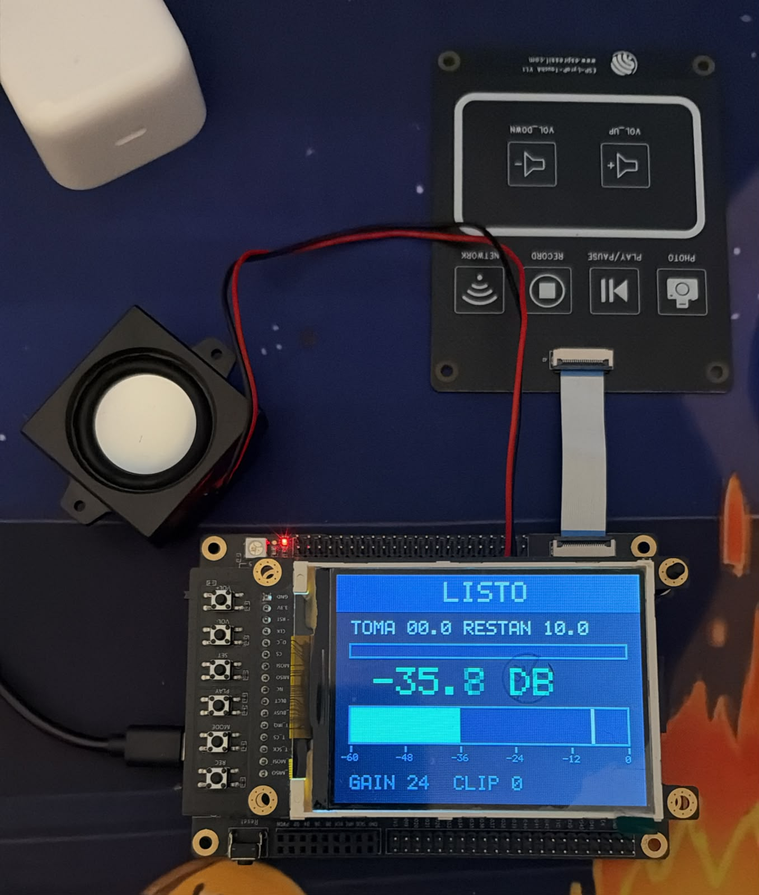
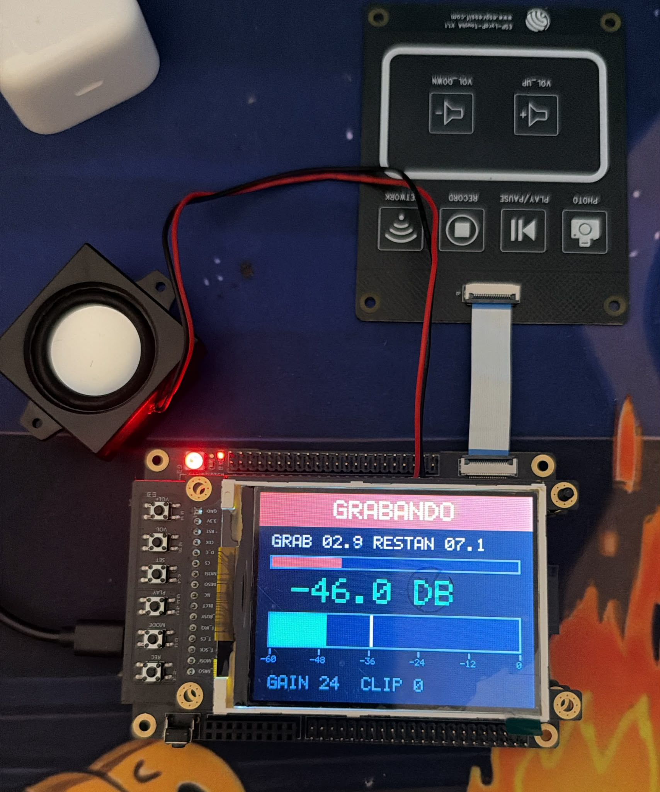
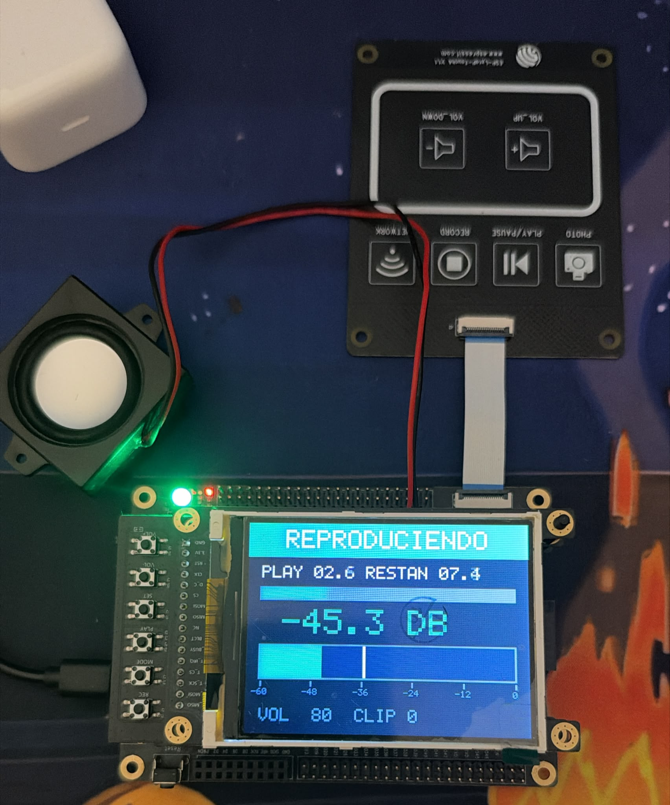

# App 5 - Grabadora de voz ESP32-S2 Kaluga-1

El objetivo del ejercicio es transformar el ejemplo `audio_vu` en una grabadora de voz utilizando la ESP32-S2 Kaluga-1.

El programa permite **grabar hasta 10 segundos de audio**, reproducirlos por un parlante y controlar la grabación mediante botones táctiles.

También muestra el estado, el tiempo y el nivel de audio en una pantalla TFT.

## Botones

| Botón | Canal | Función |
|---|---|---|
| RECORD | T5 | Iniciar o detener la grabación |
| PLAY | T2 | Reproducir o detener el audio |
| VOL_UP | T1 | Subir ganancia o volumen |
| VOL_DOWN | T3 | Bajar ganancia o volumen |

La ganancia del micrófono se modifica cuando no se está reproduciendo. Durante la reproducción, los botones VOL_UP y VOL_DOWN controlan el volumen del parlante.

## Estados de la grabadora

El programa utiliza tres estados:

### LISTO

La placa espera una acción del usuario. El LED está apagado y se puede comenzar una grabación o reproducir una toma existente.



### GRABANDO

Al tocar RECORD comienza la grabación y el LED se enciende en rojo.

La pantalla muestra el tiempo transcurrido y una barra de progreso. La grabación termina al tocar RECORD nuevamente o automáticamente después de 10 segundos.



### REPRODUCIENDO

Al tocar PLAY se escucha el audio grabado y el LED se enciende en verde.

Durante la reproducción se puede cambiar el volumen. Cuando termina, la placa vuelve automáticamente a LISTO.



## Funcionamiento del programa

Se utilizan cinco tareas de FreeRTOS:

| Tarea | Prioridad | Función |
|---|---:|---|
| control | 9 | Procesar botones y cambiar estados |
| captura | 8 | Leer y guardar el audio |
| reproduccion | 7 | Enviar audio al parlante |
| proceso | 6 | Calcular el nivel del vúmetro |
| interfaz | 3 | Actualizar pantalla y consola |

Las prioridades permiten atender primero los botones y la captura de audio, dejando la actualización de pantalla con menor prioridad.

Las tareas se comunican utilizando **colas y notificaciones**. Un **mutex** protege el estado compartido.

El audio se guarda en memoria **PSRAM**, mientras que los bloques de trabajo utilizan SRAM interna.

Se utilizan estas características:

- Frecuencia: 16.000 Hz.
- Resolución: 16 bits.
- Audio mono.
- Duración máxima: 10 segundos.
- Memoria necesaria: 320.000 bytes.

El vúmetro muestra el sonido del micrófono durante la grabación y el audio que se escucha durante la reproducción.

## Pruebas realizadas

Se realizó una grabación completa de 10 segundos.

El monitor mostró:

```text
toma 1: 10.0 s, 160000 muestras
recortes 0
medidas perdidas 0
lecturas cortas 0
```

La grabación terminó automáticamente y se pudo reproducir correctamente por el parlante.

## Mediciones

### Tiempo de captura

Cada bloque representa 32 ms de audio.

| Estado | Peor tiempo |
|---|---:|
| LISTO | 236 µs |
| GRABANDO | 437 µs |
| REPRODUCIENDO | 266 µs |

El mayor tiempo se registró durante la grabación, utilizando aproximadamente el **1,37 %** del tiempo disponible por bloque.

### Refresco de pantalla

| Estado | Peor tiempo |
|---|---:|
| LISTO | 13,2 ms |
| GRABANDO | 39,1 ms |
| REPRODUCIENDO | 36,3 ms |
| Cambio de estado | 78,1 ms |

### SRAM y PSRAM

Se comparó el tiempo de copia de 300 bloques de audio.

| Memoria | Tiempo medio por bloque |
|---|---:|
| SRAM | 29,2 µs |
| PSRAM | 129,6 µs |

La PSRAM resultó aproximadamente **4,4 veces más lenta**, pero permitió almacenar los 10 segundos sin ocupar la SRAM interna con toda la grabación.

## Conclusión

Se logró transformar el ejemplo `audio_vu` en una grabadora de voz funcional.

Durante las pruebas se pudo grabar, reproducir y controlar el volumen correctamente. La pantalla mostró los estados y el progreso del audio.

Las mediciones también mostraron que el procesamiento de los bloques de audio utiliza una parte pequeña del tiempo disponible. En la grabación probada no se registraron recortes, medidas perdidas ni lecturas cortas.
 
